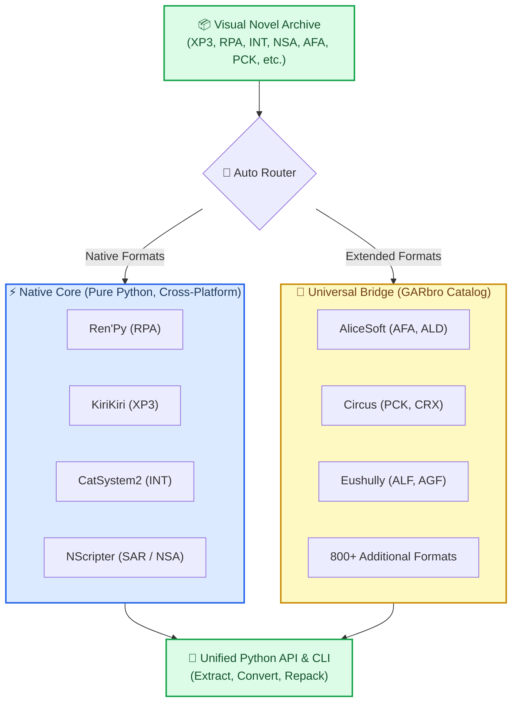

# GarEx (Game Archive Extractor & Repacker)

[](https://www.python.org/downloads/)
[](LICENSE)
[](tests/)
[](https://github.com/TakoYune/GarEx)

**GarEx** is a modern visual novel resource management library and command-line utility for Python.

Developed and maintained by **[TakoYune](https://github.com/TakoYune)**, GarEx is the open-source continuation and modernization of **[GARbro](https://github.com/morkt/GARbro)** (originally created by `morkt`). It combines lightweight, pure-Python decoders for mainstream engines with a universal bridge to support over 800 visual novel formats.

---

## ⚡ Architecture

GarEx uses a hybrid routing engine. Native pure-Python decoders run with zero dependencies across all platforms. When an archive from a specialized or older commercial engine is loaded, GarEx automatically routes requests through the bridge backend.



---

## 🎮 Features

- **Pythonic Interface**: Open, read, extract, convert, and create visual novel archives in minimal lines of code.
- **Cross-Platform Native Core**: Pure Python implementations for Ren'Py, KiriKiri, CatSystem2, and NScripter with zero external runtime requirements. Works on Windows, Linux, macOS, and Steam Deck.
- **Universal Format Catalog**: Access to 800+ visual novel formats from classic commercial engines via the bridge backend.
- **On-the-Fly Asset Conversion**: Automatically convert proprietary image formats (like Circus `.CRX`) into standard `.PNG` and audio streams into `.WAV` during extraction.
- **Verified Parity**: Native format ports are checked with differential tests enforcing byte-for-byte and metadata parity against upstream reference outputs.
- **Filesystem & Path Safety**: Sanitizes illegal filesystem characters, handles long path components, and blocks directory traversal attempts (Zip-Slip protection).

---

## 📦 Installation

```bash
pip install garex
```

To install from source for development:

```bash
git clone https://github.com/TakoYune/GarEx.git
cd GarEx
pip install -e ".[dev]"
```

---

## 🚀 Quickstart

### Python API

```python
from pathlib import Path
import garex

# 1. Open and browse an archive (automatic format detection)
with garex.open_archive("game_data.xp3") as arc:
    print(f"Format: {arc.format} | Files: {len(arc.entries())}")
    
    for entry in arc.entries()[:5]:
        print(f" - {entry.name} ({entry.size:,} bytes)")
    
    # Extract a single entry
    arc.extract("scripts/first_scene.ks", "output_dir/")
    
    # Extract all files with automatic image/audio conversion
    arc.extract_all("output_dir/", convert=True)

# 2. Standalone image and audio conversion
garex.convert_image("event_cg.crx", "event_cg.png")
garex.convert_audio("voice_clip.wav2", "voice_clip.wav")

# 3. Create a new archive or update assets
garex.create_archive(
    "patch.xp3",
    files=Path("modded_scripts/"),
    format="XP3",
)
```

### Command Line (CLI)

```bash
# List all files inside an archive
garex list game_data.xp3

# Extract archive contents to a target folder
garex extract game_data.xp3 -o ./extracted/

# Extract and convert proprietary images/audio on the fly
garex extract game_data.xp3 -o ./extracted/ --convert

# Create a new archive from a directory
garex create patch.xp3 ./modded_scripts/ --format XP3

# Convert standalone assets
garex convert cg01.crx -o cg01.png
garex convert bgm.wav2 -o bgm.wav

# View supported format catalog
garex formats
```

---

## 📊 Engine Support Matrix

### Native Pure-Python Engines (Option A)

| Engine | Format Tag | File Extensions | Status | Test Verification |
| :--- | :--- | :--- | :---: | :---: |
| **Ren'Py** | `RPA` | `.rpa` | ✅ Complete | 100% Byte Parity |
| **KiriKiri 2 / TVP** | `XP3` | `.xp3` | ✅ Complete | 100% Byte Parity |
| **CatSystem2** | `INT` | `.int` | ✅ Complete | 100% Byte Parity |
| **NScripter** | `SAR` / `NSA` | `.sar`, `.nsa` | ✅ Complete | 100% Byte Parity |

### Extended Engine Support (via Bridge)

Tested against commercial game archives with full extraction and on-the-fly conversion support:

| Engine / Developer | Format Tag | Sample Engines & Games |
| :--- | :--- | :--- |
| **AliceSoft** | `AFA`, `ALD` | System 3.x, System 4.x, Rance series, Galzoo Island |
| **CIRCUS** | `PCK`, `CRX` | Da Capo series (includes CRX $\rightarrow$ PNG conversion) |
| **Eushully** | `ALF`, `AGF` | AGE Engine, Kamidori Alchemy Meister |
| **YU-RIS** | `YPF` | CLOCKUP games, standard YU-RIS packages |
| **Waffle** | `PAK` | NekoSDK engine packages |
| **Marmalade** | `NOA` | Entis GLS engine packages |
| **Legacy Catalog** | *800+ Tags* | Nitroplus, Leaf, Key/VisualArts, Innocent Grey, and more |

For the complete list of engine families, see [docs/ENGINE_STATUS.md](docs/ENGINE_STATUS.md).

---

## 🛡️ Security & Path Safety

GarEx protects against malicious archive path injections and directory traversal attacks:

- **Traversal Protection**: Rejects `../`, absolute paths, drive specifiers, and UNC paths during extraction.
- **Filesystem Sanitization**: Replaces illegal Windows characters (`< > : " / \ | ? *`) with underscores.
- **Component Truncation**: Safely truncates path components exceeding filesystem limits (200+ characters) while preserving file extensions, preventing Win32 path overflow errors.

---

## 🤝 Contributing

Contributions are welcome. If you want to contribute a new pure-Python format decoder:

1. Check [docs/06_FORMAT_PORTING_GUIDE.md](docs/06_FORMAT_PORTING_GUIDE.md) for architectural guidelines and format templates.
2. Add differential tests in `tests/integration/` validating parity against upstream reference outputs.
3. Verify test coverage: `pytest tests/`.

---

## 📜 Credits & Heritage

- **Author & Maintainer**: **[TakoYune](https://github.com/TakoYune)**
- **Upstream Heritage**: GarEx is built on the foundation of **[GARbro](https://github.com/morkt/GARbro)**, created by **`morkt`** (Copyright © 2011–2023 morkt, MIT License). We thank `morkt` and contributors across the visual novel community for their pioneering preservation work.
- **Algorithm Credits**:
  - Okumura LZSS variant decompression (`Haruhiko Okumura`).
  - Special Picture Bitmap (SPB) and NBZ decompression routines.
  - Blowfish and Mersenne Twister cipher implementations.

---

## 📄 License

Distributed under the **MIT License**. See [LICENSE](LICENSE) and [NOTICE.md](NOTICE.md) for full terms.
