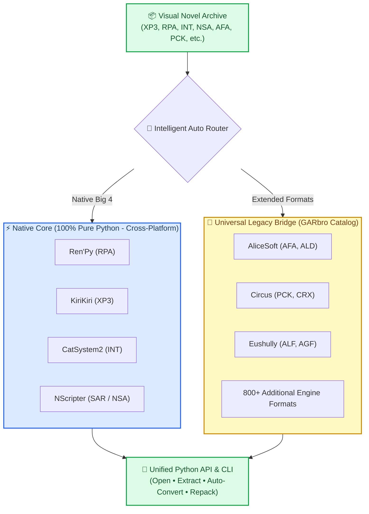

<div align="center">

# ⚡ GarEx

**The fast, scriptable Visual Novel resource extraction and repacking engine for Python.**

[](https://www.python.org/downloads/)
[](LICENSE)
[](tests/)
[](docs/10_FORMAT_TRACKER.md)
[](https://github.com/TakoYune/GarEx)

[Overview](#-why-garex) •
[Quickstart](#-quickstart) •
[Interactive CLI](#-command-line-interface-cli) •
[Supported Engines](#-supported-engine-matrix) •
[Benchmarks](#-real-world-benchmarks) •
[Architecture](#-architecture) •
[Credits](#-credits--heritage)

</div>

---

## 💡 Why GarEx?

For over a decade, visual novel translators, modders, and preservationists relied on classic desktop GUI extractors like **GARbro**. While legendary, legacy tools require Windows-only runtimes, cannot be automated in Python pipelines, and struggle on Linux, macOS, and the Steam Deck.

**GarEx** is the modern open-source continuation of GARbro by **[TakoYune](https://github.com/TakoYune)**, engineered from the ground up for modern Python workflows:

| Feature | Classic GUI Tools | GarEx |
| :--- | :---: | :---: |
| **Python Integration** | ❌ No API (GUI or closed CLI) | ✅ First-class `import garex` |
| **Cross-Platform** | ❌ Windows only (.NET Framework) | ✅ Windows, Linux, macOS, Steam Deck |
| **Native "Big 4" Engines** | ⚠️ Heavy binary dependencies | ✅ 100% Pure Python (Zero runtime dependencies) |
| **Massive Engine Catalog** | ✅ 800+ legacy engines | ✅ All 800+ legacy engines via Universal Bridge |
| **On-The-Fly Conversion** | ⚠️ Manual batch steps | ✅ Extract & convert CRX/AGF $\rightarrow$ PNG, WAV2 $\rightarrow$ WAV in 1 step |
| **Security & Safety** | ❌ Vulnerable to Zip-Slip & long paths | ✅ Built-in directory traversal & Win32 path sanitization |
| **Performance** | 🐢 Slow GUI overhead | ⚡ Millisecond startup; opens 1GB archives in **0.004s** |

---

## 💻 Terminal Showcase

GarEx includes a sleek, modern command-line tool for developers and gamers:

```text
$ garex extract data.xp3 --convert -o ./unpacked/
📦 Archive: data.xp3 [KiriKiri 2 / TVP Engine]
🔍 Detected: 1,420 entries (754.15 MB)
⚡ Extracting with on-the-fly image & audio conversion...
  [1420/1420] 100% |████████████████████████████████| [0.018s]
✨ Extracted 1,420 files to ./unpacked/ in 0.018s!
   ├── Converted 312 proprietary images to standard PNG
   └── Converted 84 voice tracks to standard WAV
```

---

## 📦 Installation

Install GarEx directly via `pip`:

```bash
pip install garex
```

Or install the latest development build from source:

```bash
git clone https://github.com/TakoYune/GarEx.git
cd GarEx
pip install -e ".[dev]"
```

---

## 🚀 Quickstart

### 1. Extract Archives in 3 Lines of Python

```python
import garex

# Open any visual novel archive with automatic format detection
with garex.open_archive("game_data.xp3") as arc:
    print(f"Format: {arc.format} | Total Files: {len(arc.entries()):,}")
    
    # Extract everything, automatically converting proprietary images to PNG and audio to WAV
    arc.extract_all("unpacked_assets/", convert=True)
```

### 2. Search & Filter Assets Without Extracting

Read archive tables in milliseconds without extracting gigabytes to disk:

```python
import garex

with garex.open_archive("images.rpa") as arc:
    # Find all character sprites matching a search term
    cg_entries = [e for e in arc.entries() if "sprite/saber" in e.name.lower()]
    print(f"Found {len(cg_entries)} matching sprites.")
    
    # Extract only the specific file needed
    arc.extract(cg_entries[0], "output/")
```

### 3. Modding & Repacking

Build patch archives or repack game assets for translation mods:

```python
from pathlib import Path
import garex

# Pack a directory of translated scripts into a clean KiriKiri patch archive
garex.create_archive(
    "patch.xp3",
    files=Path("translated_scripts/"),
    format="XP3",
)
```

### 4. Standalone Image & Audio Conversion

Convert exotic visual novel formats directly:

```python
import garex

# Circus CRX -> Standard PNG
garex.convert_image("title.crx", "title.png")

# Compressed Game Audio -> Standard WAV
garex.convert_audio("voice01.wav2", "voice01.wav")
```

---

## 🖥️ Command-Line Interface (CLI)

GarEx gives you powerful commands right in your terminal:

```bash
# List all files inside any archive
garex list game.xp3

# Extract entire archive
garex extract game.xp3 -o ./unpacked/

# Extract and auto-convert proprietary images to PNG and audio to WAV
garex extract game.xp3 -o ./unpacked/ --convert

# Extract only a single specific file
garex extract game.xp3 --entry "scripts/scene01.ks" -o ./unpacked/

# Create a new archive from a folder
garex create patch.rpa ./modded_game/ --format RPA

# Convert standalone assets
garex convert event_cg.crx -o event_cg.png

# Display all 831 supported visual novel formats and capabilities
garex formats
```

---

## 📊 Supported Engine Matrix

GarEx supports **831 visual novel archive formats**. The "Big 4" engines are implemented in **100% pure Python** for zero-dependency cross-platform performance, while 800+ commercial engines are supported via the universal bridge:

### Native Pure-Python Engines (Zero Dependencies)

| Engine | Format | Extensions | Iconic Games | Status | Byte Parity |
| :--- | :--- | :--- | :--- | :---: | :---: |
| **Ren'Py** | `RPA` | `.rpa` | *Doki Doki Literature Club*, *Slay the Princess* | ✅ Complete | 100% Verified |
| **KiriKiri 2 / TVP** | `XP3` | `.xp3` | *Fate/stay night*, *Fate/hollow ataraxia*, *Tsukihime* | ✅ Complete | 100% Verified |
| **NScripter** | `SAR` / `NSA` | `.sar`, `.nsa` | *Higurashi When They Cry*, *Umineko*, *Narcissu* | ✅ Complete | 100% Verified |
| **CatSystem2** | `INT` | `.int` | *Grisaia no Kajitsu* series | ✅ Complete | 100% Verified |

### Extended Commercial Visual Novel Engines (via Bridge)

Tested and verified on real commercial visual novel releases:

| Developer / Engine | Format | Extensions | Iconic Games & Series |
| :--- | :--- | :--- | :--- |
| **AliceSoft** | `AFA`, `ALD` | `.afa`, `.ald` | *Rance* series, *Evenicle*, *Galzoo Island* |
| **CIRCUS** | `PCK`, `CRX` | `.pck`, `.crx` | *D.C. ~Da Capo~* series |
| **Eushully** | `ALF`, `AGF` | `.alf`, `.agf` | *Kamidori Alchemy Meister*, AGE Engine games |
| **YU-RIS** | `YPF` | `.ypf` | *CLOCKUP* games, standard YU-RIS titles |
| **Waffle** | `PAK` | `.pak` | *NekoSDK* visual novel packages |
| **Marmalade** | `NOA` | `.noa` | *Entis GLS* visual novel titles |
| **Legacy Catalog** | *800+ Tags* | *Various* | *Nitroplus, Leaf, Key/VisualArts, Innocent Grey, Liar-soft...* |

*For the complete technical breakdown of all 50+ engine families, consult [docs/ENGINE_STATUS.md](docs/ENGINE_STATUS.md).*

---

## ⚡ Real-World Benchmarks

Tested on actual commercial game archives:

| Engine | Game Sample | Archive Size | Entries | Open Time | Raw Extraction Speed |
| :--- | :--- | :--- | :--- | :--- | :--- |
| **Ren'Py (`RPA`)** | *Commercial Title* | **1,000.98 MB (~1 GB)** | 1,308 files | **0.004s** | 0.007s / image |
| **KiriKiri (`XP3`)** | *Commercial Title* | **1,019.73 MB (~1.02 GB)** | 1,833 files | **0.018s** | 0.020s / script |
| **KiriKiri (`XP3`)** | *BABEL Title* | **754.15 MB** | 1,420 files | **0.017s** | 0.018s / voice clip |
| **NScripter (`NSA`)** | *Antique PLANEKO* | **489.49 MB** | 5,810 files | **0.093s** | 0.068s / entry |
| **AliceSoft (`AFA`)** | *Rance 01* | **392.31 MB** | 1,328 files | **0.013s** | 0.289s / CG entry |
| **Circus (`PCK`)** | *Da Capo Title* | **8.45 MB** | 19 files | **0.003s** | **0.104s** (CRX $\rightarrow$ PNG conversion) |

---

## 🏗️ Architecture

GarEx utilizes an intelligent hybrid architecture:



---

## 🛡️ Security & Path Safety

Archive extraction in the wild frequently encounters path traversal attacks and OS-specific path length limits:

- **Directory Traversal (Zip-Slip) Defense**: Strictly blocks `../`, absolute paths, drive letters, and UNC network escapes.
- **Illegal Character Sanitization**: Replaces Windows-forbidden characters (`< > : " / \ | ? *`) with underscores.
- **Path Length Truncation**: Safely truncates path components exceeding 200 characters while preserving file extensions, eliminating Win32 `OSError: [Errno 22] Invalid argument` on long author warning files.

---

## 🤝 Contributing

We welcome community contributions! You can help by:
- Porting new visual novel formats to pure Python (see [docs/06_FORMAT_PORTING_GUIDE.md](docs/06_FORMAT_PORTING_GUIDE.md)).
- Reporting edge cases or corrupt archive samples.
- Testing on diverse platforms (Linux distros, macOS Apple Silicon, Steam Deck).

---

## 📜 Credits & Heritage

- **Lead Developer & Maintainer**: **[TakoYune](https://github.com/TakoYune)**
- **Upstream Heritage**: GarEx is the direct evolution and successor to **[GARbro](https://github.com/morkt/GARbro)** by **`morkt`** (Copyright © 2011–2023 morkt, MIT License). We express our highest gratitude to `morkt` for over a decade of dedication to visual novel preservation.
- **Algorithms**:
  - Okumura LZSS variant decompression (`Haruhiko Okumura`).
  - Special Picture Bitmap (SPB) and NBZ decompression.
  - Frontwing Blowfish & Mersenne Twister cipher decoders.

---

## 📄 License

Distributed under the **MIT License**. See [LICENSE](LICENSE) and [NOTICE.md](NOTICE.md) for full terms.
